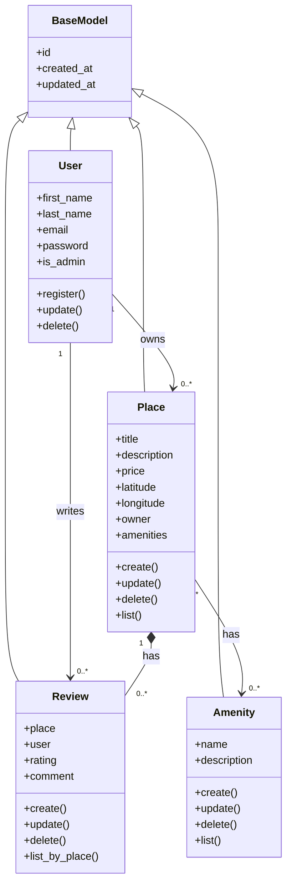

# Detailed Class Diagram — Business Logic Layer

## Entities

- **BaseModel:** parent class. Gives every entity a unique `id` and the `created_at` / `updated_at` dates.
- **User:** a person using the app. Can register, update their profile and be deleted. `is_admin` marks administrators.
- **Place:** a property listed by a user (its owner), with a price, a location and a list of amenities.
- **Review:** a rating and a comment that a user leaves on a place.
- **Amenity:** a feature a place can have, like Wi-Fi or a pool.

## Relationships

- **Inheritance (`<|--`):** all 4 entities inherit the ID and the dates from BaseModel.
- **User owns Places:** one user can own many places.
- **User writes Reviews:** one user can write many reviews.
- **Place has Reviews (composition `*--`):** reviews belong to a place; if the place is deleted, its reviews are too.
- **Place has Amenities:** a place can have many amenities, and an amenity can be in many places.