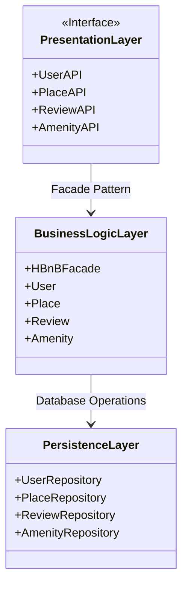

# High-Level Package Diagram

## Layers

### Presentation Layer
Handles the interaction with the user. It receives requests through the API endpoints (users, places, reviews, amenities) and sends back the responses.

### Business Logic Layer
Contains the core models (User, Place, Review, Amenity) and the rules of the application, such as validating data before it is saved.

### Persistence Layer
Stores and retrieves data from the database. Each entity has a repository that handles saving, reading, updating and deleting its records.

## Facade Pattern
The HBnBFacade is a single entry point into the Business Logic Layer.