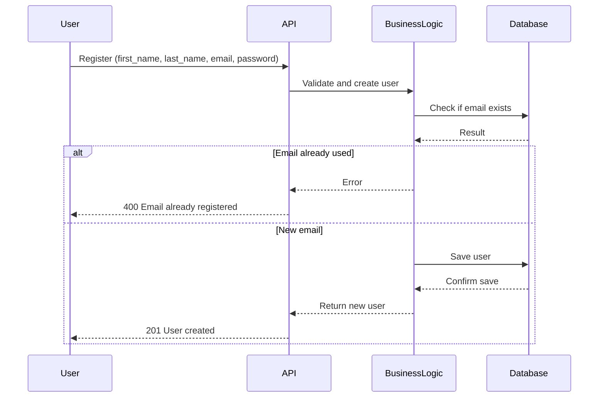
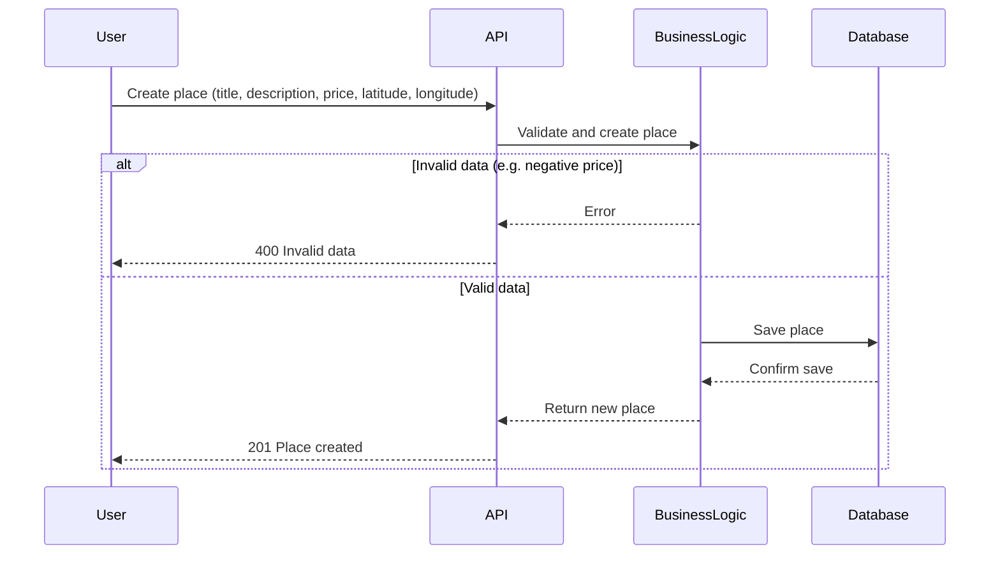
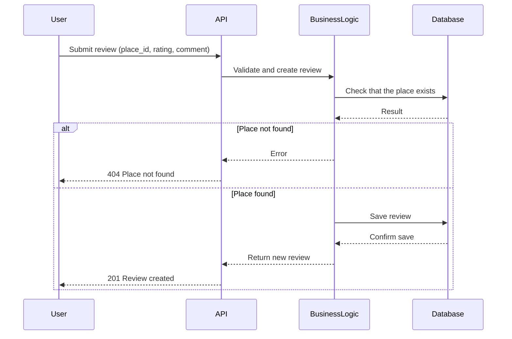
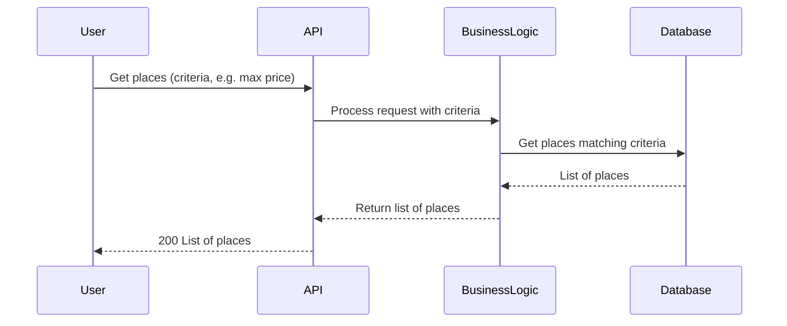

# Sequence Diagrams for API Calls

## 1. User Registration

## 2. Place Creation

## 3. Review Submission

## 4. Fetching a List of Places

## How Each Layer Contributes

- **API (Presentation):** receives the request and sends back the response with a status code.
- **BusinessLogic:** applies the rules (unique email, valid price, existing place) and decides whether the request succeeds.
- **Database (Persistence):** saves and reads the data.