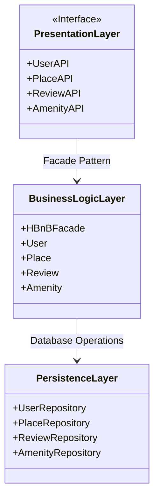
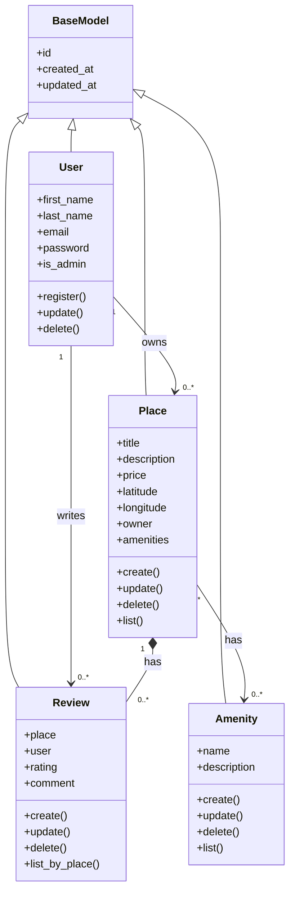
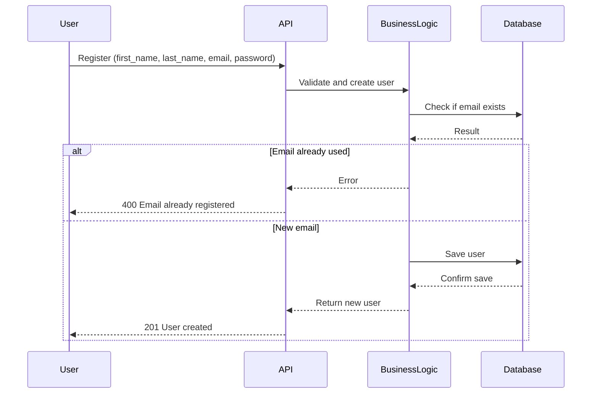
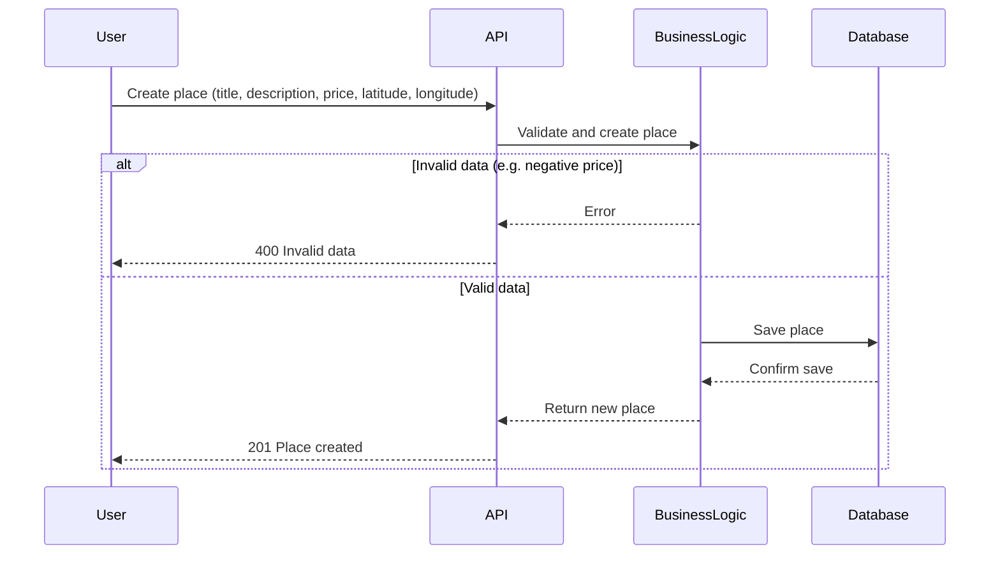
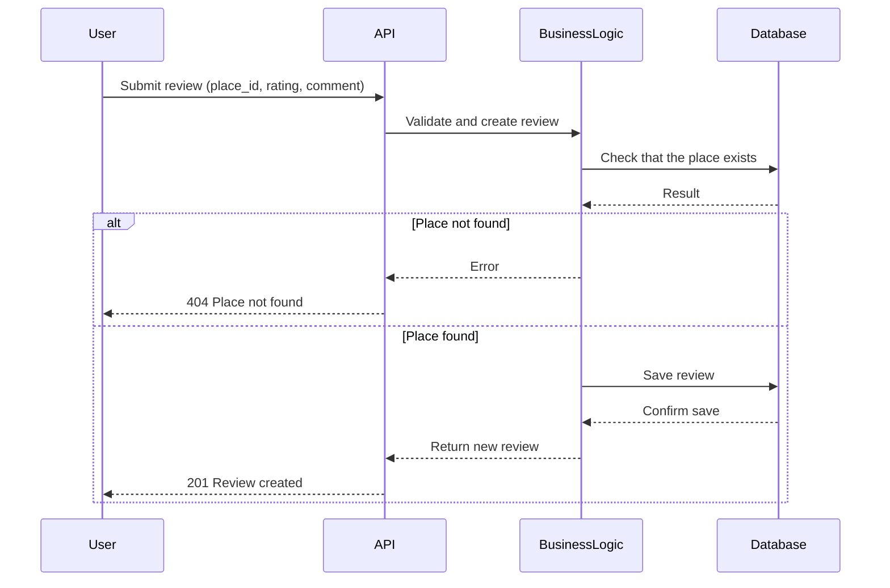
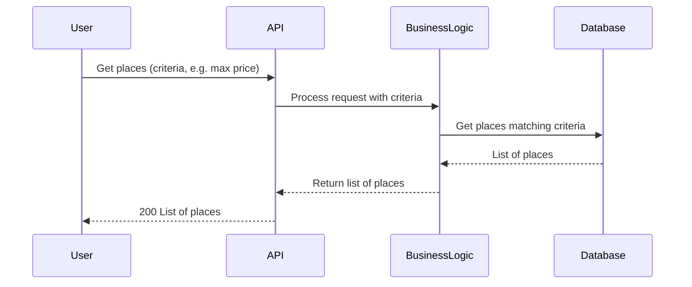

# HBnB Evolution — Technical Documentation

## 1. Introduction

**HBnB Evolution** is a simplified AirBnB-like application. Users can register, list places, leave reviews, and add amenities to places.

**Purpose of this document:** it is the blueprint for building the application. It shows how the app is organized, which entities it uses, and how a request moves through the system.

**What it contains:**
1. **High-Level Architecture:** the three layers of the app and the facade pattern
2. **Business Logic Layer:** the entities, their attributes, methods and relationships
3. **API Interaction Flow:** the step-by-step flow of four API calls

All diagrams use UML notation, written with Mermaid.js.

## 2. High-Level Architecture

**Purpose:** shows how the application is split into layers and how those layers communicate.

**Key components:**
- **Presentation Layer:** handles the interaction with the user. It receives requests through the API (users, places, reviews, amenities) and sends back the responses.
- **Business Logic Layer:** contains the models (User, Place, Review, Amenity) and the rules of the application, such as validating data before it is saved.
- **Persistence Layer:** stores and retrieves data from the database, with one repository per entity.

**Facade pattern:** the `HBnBFacade` is the single entry point into the Business Logic Layer. The Presentation Layer only calls the facade instead of calling the models or the database directly.

**Design decisions:**
- **Layers** keep each part focused on one job, so the code is easier to understand, test and change.
- **The facade** keeps the layers independent: if the models or the database change, the API code does not need to change.

**How it fits:** this is the overall structure. The next two sections zoom into the Business Logic Layer and into how requests travel through these layers.

## 3. Business Logic Layer

**Purpose:** shows the entities of the business logic, what data they hold, what they can do, and how they are related.

**Key classes:**
- **BaseModel:** parent class. Gives every entity a unique `id` and the `created_at` / `updated_at` dates required for auditing.
- **User:** a person using the app. Can register, update their profile and be deleted. `is_admin` marks administrators.
- **Place:** a property listed by a user (its owner), with a title, description, price, location and a list of amenities.
- **Review:** a rating and a comment that a user leaves on a place.
- **Amenity:** a feature a place can have, like Wi-Fi or a pool.

**Relationships:**
- **Inheritance (`<|--`):** all four entities inherit the ID and the dates from BaseModel.
- **User owns Places (1 to many):** one user can own many places; each place has one owner.
- **User writes Reviews (1 to many):** one user can write many reviews.
- **Place has Reviews (composition):** reviews belong to a place; if the place is deleted, its reviews are too.
- **Place has Amenities (many to many):** a place can have many amenities, and an amenity can be in many places.

**Design decisions:**
- **BaseModel** avoids repeating the ID and dates in every class, and guarantees every object has them.
- **Composition for reviews** because a review has no meaning without its place.
- **Many-to-many for amenities** because the same amenity (for example Wi-Fi) is shared by many places.

**How it fits:** these are the models inside the Business Logic Layer from section 2. The facade uses them to apply the business rules.

## 4. API Interaction Flow

These diagrams show how a request travels through the layers: **API** (Presentation) → **BusinessLogic** (Business Logic) → **Database** (Persistence), and how the response comes back.

**How to read them:** time goes from top to bottom. Solid arrows are requests; dashed arrows are responses. `alt` / `else` shows two possible paths, an error or a success.

### 4.1 User Registration

### 4.2 Place Creation

### 4.3 Review Submission

### 4.4 Fetching a List of Places

**How each layer contributes:**
- **API (Presentation):** receives the request and sends back the response with a status code.
- **BusinessLogic:** applies the rules (unique email, valid price, existing place) and decides whether the request succeeds.
- **Database (Persistence):** saves and reads the data.

**Design decision:** every request follows the same path through the layers, and every rule is checked in the Business Logic Layer, never in the API or the database. This keeps the behavior consistent across all API calls.

## 5. Conclusion

This document defines the structure of HBnB Evolution: a three-layer architecture connected through a facade, a Business Logic Layer built on five classes, and a clear flow for each main API call. It will be the reference for implementing the API and business logic in Part 2 and the database in Part 3.